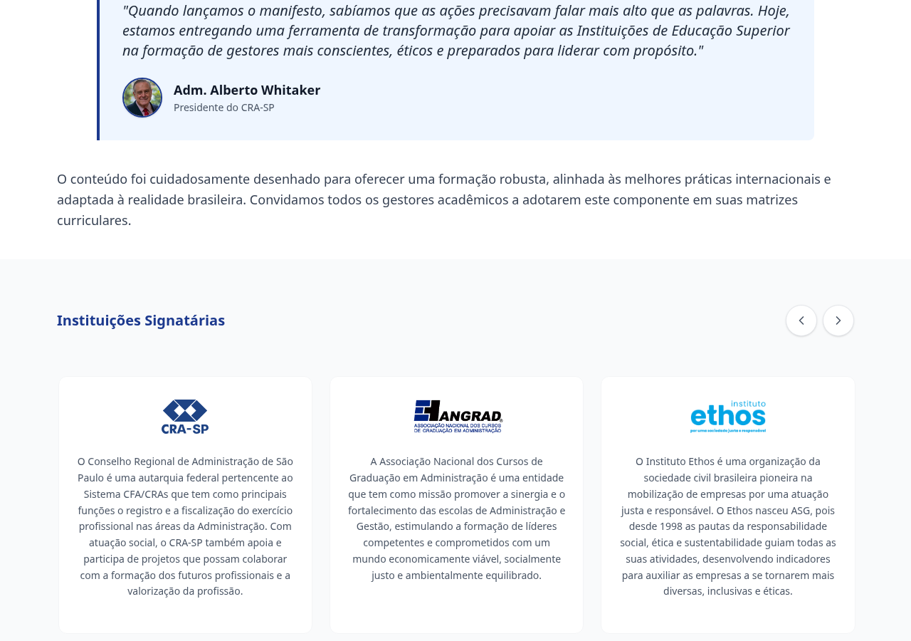

# 1. Parecer consolidado, achados e nota

**Data:** 13/10/2026, America/Sao_Paulo. **Repositório:** `desenvolvimentoprofissional-oss/asg-ods`. **Commit:** `3baf58e04238ca61a386a03e39e0932de430693a`. **Base anterior:** `9a126c65ba902e19b31bc695be0ccc172df7167f`. O HEAD da main remota foi conferido no início e no encerramento das verificações.

## 1.1 Parecer e nota

**Nota técnica geral: 8,5/10. Não foi demonstrada vulnerabilidade alta/crítica alcançável no código próprio. A publicação por instalação limpa via npm permanece bloqueada pelo lockfile desatualizado.**

O código compilou, passou no TypeScript, nos 31 testes existentes, no novo ESLint e nas métricas. O runtime de produção local também passou nas verificações de rotas, cabeçalhos, SRI dos assets e rejeição de JSON inválido/excessivo. Esses resultados foram obtidos com a árvore de dependências já preparada para a aplicação e ferramentas de lint isoladas; eles não demonstram que uma instalação limpa do manifesto atual funciona com o lock npm.

Antes de uma publicação que use npm, o manifesto e o lock precisam voltar a corresponder e a instalação limpa deve passar. A proteção de integridade retirada do script VLibras e o foco invisível do carrossel também merecem correção. O primeiro é perda de defesa preventiva, e o segundo é falha de navegação por teclado; não foram classificados como ataques ou vazamentos.

Se a implantação utiliza Bun, a falha de npm não prova que esse processo falhará: o novo Bun lock é estruturalmente coerente, mas uma instalação congelada com Bun não foi executada nesta sessão. Portanto este parecer não certifica esse caminho de entrega nem o ambiente publicado.

## 1.2 Achados confirmados

| ID | Categoria e prioridade | Evidência atual | Consequência e encaminhamento |
| --- | --- | --- | --- |
| R01 | Instalação/entrega: bloqueia o fluxo npm | `package.json` ganhou quatro dependências ESLint; `package-lock.json` permanece igual à base e não as contém. A validação de `npm ci`, com cache gravável, retorna `EUSAGE`; a variante `--omit=dev` também falha. | Corrigir/versionar o lock npm e repetir a instalação limpa. O Bun lock não é consumido pelo npm. Não é falha de runtime ou brecha causada pelo ESLint. |
| R02 | Segurança preventiva: média | `VLibrasWidget.tsx` removeu `VLIBRAS_SRI_HASH` e `script.integrity`. A tag real usa URL mutável e `data-version="7.12.2"`, que não verifica os bytes. | Uma alteração inesperada do arquivo externo deixa de ser rejeitada por divergência de hash. Definir aprovação/versionamento e integridade compatíveis com o fornecedor; não recolocar cegamente um hash antigo. Nenhum comprometimento externo foi observado. |
| R03 | Acessibilidade/uso: média | Após Tab chegar ao primeiro cartão de signatário, o loop reposiciona o carrossel em cerca de 150 ms. O cartão continua focado, mas passa para x=-1825, fora do contêiner x=76..1204. | O usuário de teclado perde a indicação visível do foco. O loop precisa preservar a visibilidade e a posição do elemento focado. Os novos links são legítimos, mas devem funcionar também pelo teclado. |
| R04 | Configuração: baixa e condicional | A CSP do Express ganhou três hashes SHA-256 de `style-src`; `firebase.json` não recebeu esses hashes. As demais diretivas produtivas coincidem. | Um estilo que dependa de um desses hashes pode ser autorizado pelo Express e recusado no HTML do Hosting. Não foi demonstrado que o CSS real do widget exija esses hashes nem que o domínio publicado tenha quebra. Conferir a política do caminho efetivamente usado. |

O primeiro erro de npm observado foi `ENOENT` no cache padrão do ambiente. Ele não foi atribuído ao projeto. A nova tentativa com cache próprio isolou e comprovou a divergência de lock por `EUSAGE`. Foi usado `--dry-run` para validar o instalador sem remover a árvore existente; a checagem de sincronia impede a instalação antes dessa etapa. Logs: `npm-ci-clean-cache.log` e `npm-ci-production-validation.log`.

R02 é uma mudança concreta na verificação do primeiro arquivo JavaScript externo. TLS e a lista de origens da CSP permanecem ativos, mas não fixam os bytes desse recurso. O SRI dos assets locais do Vite é separado e continua correto. O script oficial não pôde ser carregado neste ambiente por falha de túnel/403; isso foi registrado como limite de rede, não como defeito da produção.

R03 foi reproduzido em Chromium usando foco por teclado e medição do elemento antes/depois do reposicionamento. O foco de alto contraste foi retestado pelo teclado: o contorno amarelo sólido de 3 px aparece corretamente. Um resultado anterior obtido por foco programático não foi usado como achado.

## 1.3 Alterações verificadas sem regressão identificada

- As três âncoras novas da metodologia encontram os IDs corretos; a navegação repetida para o mesmo hash e o acesso direto ao módulo 6 funcionaram.
- Os cartões de signatários e o rodapé usam destinos HTTPS constantes, com `noopener noreferrer`. As redes sociais do rodapé agora reutilizam os mesmos destinos da barra superior.
- Os controles de fonte/contraste em rem acompanham a escala: 30 px passam a 36 px e 11 px a 13,2 px na escala 1,2. A chamada de interesse permaneceu dentro do hero, sem overflow horizontal, nos tamanhos testados de 320, 390, 640 e 1280 px.
- O modal de privacidade abriu, fechou com Escape e devolveu o foco ao acionador nos cenários verificados.
- A anotação TypeScript mais precisa de `setHeader` preservou o comportamento de cookies escalares, listas, arrays congelados, SameSite existente e cabeçalhos numéricos.
- API, schema Zod, cofre AES-GCM/HMAC, transações, seleção Firebase e regras Firestore permanecem iguais à revisão anterior. Não foi adicionada rota de leitura dos leads/cofre nem entrada controlada pelo usuário em destinos externos.
- As duas expressões regulares alteradas no analisador de métricas mantêm o significado. As métricas reais retornaram 91 arquivos, 485 executáveis e zero erros. `CODIGOFONTE.txt` corresponde à saída dos 110 arquivos selecionados nessa versão.

## 1.4 Verificações e evidências

| Verificação | Resultado | Evidência |
| --- | --- | --- |
| TypeScript | Passou | `typecheck.log` |
| Build Vite + injeção SRI | Passou | `build.log` |
| Testes existentes | 31 passaram; 0 falharam; quatro arquivos | `tests.log` |
| ESLint | 91 arquivos; zero erros e avisos | `eslint-isolated.json`, `tooling.md` |
| Métricas | 91 arquivos; 485 executáveis; zero erros | `metrics-current.json`, `metrics-ledger.json` |
| Instalação npm com lock | Falhou por `EUSAGE`, inclusive omitindo devDependencies | `npm-ci-clean-cache.log`, `npm-ci-production-validation.log` |
| Runtime produtivo local | Iniciou com Node 24.19.0 e `NODE_ENV=production` | `server.log` |
| HTTP, fonte interna e assets | 18 checks passaram; dois hashes SRI recalculados e conferidos | `runtime-smoke.json` |
| Navegador | Âncoras, URLs, reflow, fonte e modal passaram; foco do carrossel falhou | `frontend-evidence.json`, `card-focus-after-balance.png`, `high-contrast-keyboard.json` |
| Cabeçalhos e cookies | Sondagens passaram; divergência CSP de estilos identificada | `backend-evidence.json`, `backend.md` |
| VLibras | Tag sem SRI confirmada; recurso oficial não carregou por bloqueio de rede do ambiente | `vlibras.md`, `vlibras-evidence/` |
| Dependências produtivas | Duas entradas altas da mesma cadeia React Router; zero críticas | `npm-audit-production.json`, `security-independent.md` |

O ESLint foi executado com uma cópia byte a byte da configuração atual e as versões diretas registradas no Bun lock, instaladas fora do checkout. O wrapper `npm run lint` não foi executado porque sua última etapa regrava um relatório versionado; ESLint, TypeScript e métricas foram conferidos separadamente. Isso preservou os arquivos do autor e não ocultou a falha de instalação.

Os advisories de React Router não foram descartados apenas porque a aplicação é SPA: também foram considerados os de redirects e matching no cliente. SSR/RSC/framework handlers não existem neste servidor, e os destinos de navegação relevantes são constantes. Não foi demonstrado vetor explorável nos fluxos atuais, nem foram contadas duas entradas da mesma cadeia como dois incidentes produtivos.

## 1.5 Critérios da nota

São os mesmos pesos da avaliação anterior. A nota é julgamento técnico do código e da entrega verificável, não certificação de segurança nem pontuação dos scanners.

| Critério | Nota | Peso | Fundamentação |
| --- | --- | --- | --- |
| Segurança do código próprio | 8,5/10 | 60% | Controles de servidor e dados preservados, sem vetor alto/crítico demonstrado; integridade do primeiro script remoto VLibras retirada. |
| Integridade e comportamento | 8,5/10 | 25% | Melhorias de links, âncoras e fonte verificadas; novo foco invisível no carrossel reproduzido. |
| Verificação e cobertura | 7/10 | 15% | Lint novo e checks locais passaram; instalação limpa npm bloqueada e transações/IAM publicados não executados. |

Média ponderada: 8,275; apresentação na mesma escala de meio ponto: **8,5/10**. A redução em relação a 9/10 decorre dos achados novos, não dos avisos de scanners nem da ausência de chaves neste ambiente.

## 1.6 Limites e preservação

Não foram solicitadas/lidas chaves privadas ou credenciais reais; não houve cadastro/gravação em Firestore de produção nem teste de concorrência real no banco publicado. Portanto persistência real, IAM, regras efetivas e o SHA do serviço implantado continuam fora do resultado comprovado. As capturas anteriormente fornecidas permanecem evidência de configuração e registros existentes; a falta de acesso do auditor não foi transformada em falha do usuário.

Permanecem as observações anteriores de UX/acessibilidade e as condições operacionais já contextualizadas. Esta revisão não atribui conformidade integral WCAG ou conclusão jurídica. Os excelentes resultados externos fornecidos pelo usuário não foram reexecutados nem usados como prova de todos os fluxos internos.

A comparação cobriu os 24 arquivos alterados e os fluxos adjacentes relevantes. Fontes, testes, lockfiles e configurações não foram editados pelo auditor; a atualização local foi apenas fast-forward para o código disponibilizado no GitHub. Os artefatos desta auditoria ficam fora do checkout. Os documentos anteriores, suas fontes e a branch de entrega foram preservados; seus hashes PDF/Word foram reconferidos. A documentação continua pausada.

Observações menores de ferramentas: duas referências de linha do relatório de métricas estão deslocadas em uma linha, sem números errados; o exportador agora inclui `.env.example`, enquanto a regra textual `.env.*` do AGENTS não explicita essa exceção. O arquivo atual contém placeholders, sem segredo real: isso não foi apresentado como vazamento nem impedimento produtivo.

# 2. Interface, navegação e acessibilidade

Commit atual: `3baf58e04238ca61a386a03e39e0932de430693a`; comparação com `9a126c65ba902e19b31bc695be0ccc172df7167f`. Verificações no Chromium 154 contra build novo de produção em `http://127.0.0.1:3011`. Fontes, testes e documentação não foram alterados. Contador de cadastro: **zero POSTs**, sem gravações no banco ou navegação aos destinos institucionais externos.

## 2.1 Resultado

Foi confirmada **uma regressão de acessibilidade de severidade média**: o novo link do primeiro cartão recebe foco por teclado e, em seguida, o reposicionamento do carrossel leva esse elemento para fora da área visível. Trata-se de foco/navegação visual; não é bypass, XSS, exposição de dados ou incidente de segurança. Não foi confirmada falha de segurança nos novos URLs de cartões/rodapé ou no processamento das âncoras.

## 2.2 F01 — Média, acessibilidade: foco fica na cópia invisível do cartão

**Fontes atuais:** `src/components/presentation/SignatoryCard.tsx:10` tornou o cartão um link; `src/components/presentation/SignatoriesCarousel.tsx:47` renderiza três cópias; `src/components/presentation/useSignatoriesCarousel.ts:27–33` reposiciona a rolagem; `:98–101` agenda esse reposicionamento após o evento de scroll.

**Cenário reproduzido:** em `/chancela`, partir do botão “Próximo” e pressionar Tab para entrar nos cartões. O primeiro link, CRA-SP, recebe foco com `:focus-visible=true` e `scrollLeft=0`. Inicialmente seu retângulo começa em `x=80`, dentro do container `x=76…1204`. Após 600 ms, `scrollLeft` passa a 1905; o elemento ativo continua sendo a **cópia de índice 0**, agora em `x=-1825`, inteiramente fora do container. A cópia visualmente equivalente que aparece na tela não recebe o foco.

**Impacto:** usuário de teclado perde a localização visual do link focado. O indicador de foco existe, mas está no cartão oculto pela rolagem. O comportamento é relevante aos critérios de foco visível e foco não inteiramente oculto da WCAG. O link permanece identificado no DOM; não se afirma perda de autorização ou desvio do destino.

**Relação com o baseline:** o loop já existia; os cartões eram divs sem esse alvo de tabulação. Converter as três cópias em links introduz o cenário. A correção anterior dos indicadores dos botões, A08, continua presente; esse achado trata do elemento focado sair da viewport, não da ausência de uma regra CSS de foco.

**Ação indicada:** manter o cartão focado visível durante o reposicionamento, coordenando o foco com as cópias do carrossel e os alvos de tabulação. Não foi feita correção de código.

Evidências: `frontend-evidence.json`, chaves `card_focus_immediate`/`card_focus_after_balance`; `card-focus-after-balance.png`; reprodução em `frontend-probe.py`.

## 2.3 Verificações que passaram no escopo observado

| Área | Evidência observada |
| --- | --- |
| Âncoras da metodologia | Os três links do footer encontram os novos IDs e rolam para a seção correspondente. |
| Reentrada no mesmo hash | Clicar novamente “Flexibilidade de Implementação” volta à seção; alvo em `y=-0,5px` ao fim da rolagem. |
| Link direto da trilha | `/trilha#modulo-6` apresenta o módulo; posição aproximada `y=127,75px`, compatível com scroll-margin. |
| Novos destinos externos | Cinco destinos constantes HTTPS, com `target=_blank` e `rel=noopener noreferrer`, nos cartões e rodapé. Sem URLs de entrada externa processadas nesses dados. |
| Redes sociais | Footer utiliza `TOPBAR_SOCIAL_ITEMS`, unificando seus destinos com os da barra superior. |
| Toolbar em rem | A+ cresce de 30×30px/11px para 36×36px/13,2px quando a escala passa de 1 para 1,2. |
| Reflow/escala da home | Viewports 1280, 640, 390 e 320px, fonte 1,2; largura de scroll igual à viewport e CTA dentro do retângulo do hero. |
| Foco em alto contraste | Com Tab verdadeiro, cartão tem outline **amarelo sólido de 3px**; nenhuma falha global de foco HC foi confirmada. |
| Diálogo | Modal nativo abre; Escape fecha e devolve foco ao botão de privacidade. |

Referências: `PublicLayout.tsx:18–28`; `constants/footer.ts:3–20`; IDs em `MetodologiaPillars.tsx:20`, `MetodologiaFormats.tsx:24`, `MetodologiaImplementation.tsx:24`; `constants/chancela.ts:14`, `:26`, `:37`, `:51`, `:66`; `SignatoryCard.tsx:11–18`; `Footer.tsx:29–44` e `:71–77`; `TopBarFontSizeButtons.tsx:13–17`.

## 2.4 Observação visual delimitada

No hit-test adicional de home a 320px com fonte 1,2, a base do CTA sobrepõe a faixa de logos em aproximadamente **24,25px**. O centro do botão continua recebendo o hit-test corretamente. Fontes: hero com altura fixa em `HomeHero.tsx:93` e faixa absoluta em `HomeLogosBar.tsx:33–34`. A mudança diminui a fonte e altera as margens do hero; este teste não estabelece que a sobreposição tenha sido introduzida pelo commit. Registra-se como observação visual de baixa prioridade, sem classificá-la como nova regressão de segurança ou bloqueio de cadastro.

Evidências: `hero-hit-test.json`, `home-320-hero-120.png`. Reflow em viewport estreita e escala 1,2 não substitui teste completo de zoom nativo do navegador.

## 2.5 Contexto preservado e limites

Os fluxos do formulário, normalização de telefone e nome acessível de retorno não foram alterados por este diff; as correções já registradas de A03/A15/A17/A18 não são reabertas. A16 continua separado entre títulos e gerenciamento de foco. O autoplay/atalhos anteriormente descritos mantêm seu contexto; F01 é o novo cenário de links focados no loop.

O valor `high_contrast_card_focus` do primeiro JSON provém de foco programático após click do mouse, sem estabelecer `:focus-visible`; seu outline não sólido **não é um achado**. A verificação correta está em `high-contrast-keyboard.json`, com `focusVisible=true` e outline sólido de 3px.

Não foram coletados elementos STYLE inline no DOM das páginas percorridas (`inline_styles=[]`). Portanto este probe não demonstra quebra funcional causada pela diferença dos três hashes de style-src entre Express e Firebase Hosting, discutida no relatório backend. A remoção de SRI no carregador VLibras foi observada no diff e comunicada ao agente principal para a análise paralela de integridade; não foi demonstrada exploração por esse caminho.

Sem POST/cadastro, testes de carga, validação de titularidade/disponibilidade dos destinos externos, leitores de tela ou browsers além de Chromium. Artefatos e screenshots ficam fora do checkout; o relatório documentacional anterior permaneceu intacto.

# 3. Backend, dados e cabeçalhos HTTP

Revisão: `3baf58e04238ca61a386a03e39e0932de430693a`. Base: `9a126c65ba902e19b31bc695be0ccc172df7167f`.

**Não foi identificada regressão backend de severidade alta/crítica ou impedimento concreto de segurança na API, Firestore ou criptografia.** O código dessas áreas permanece igual à base. A mudança dos cabeçalhos amplia três hashes de estilo específicos; os testes locais confirmaram os demais cabeçalhos e o tratamento de cookies. Há uma diferença confirmada entre as políticas CSP do Express e do Firebase Hosting, descrita abaixo com seu alcance.

## 3.1 Alterações e alcance

No escopo backend, apenas `src/server/securityHeaders.ts` mudou: linhas12-14 acrescentam três hashes SHA-256 em `style-src`;87 substitui o tipo TypeScript `any` do valor de `setHeader` por `number | string | readonly string[]`.

Os hashes são permissões para conteúdos específicos de elementos de estilo. Nenhuma origem nova foi adicionada. `script-src`, `connect-src`, `frame-ancestors`, `object-src`, demais diretivas e política de desenvolvimento permanecem iguais. A mudança mantém `default-src 'none'`, `object-src 'none'` e a ausência de `unsafe-inline`/`unsafe-eval` em `script-src` produtivo. A permissão já existente de `style-src-attr 'unsafe-inline'` não foi alterada.

A alteração do tipo de `setHeader` não muda a função JavaScript executada. Foram testados no Express real: cookie escalar, lista de cookies, array congelado (equivalente runtime ao tipo readonly), cookie com SameSite=Strict, cookie com SameSite=None e cabeçalho numérico comum. Cookies receberam Secure/HttpOnly e SameSite=Lax quando ausentes; valores Strict/None existentes foram mantidos e o cabeçalho numérico passou normalmente. Não foi constatada regressão desse tratamento.

## 3.2 Diferença CSP entre caminhos de publicação

**Achado confirmado de configuração declarada, prioridade baixa; efeito funcional dependente do caminho servido.**

Referências: `src/server/securityHeaders.ts:12` e `firebase.json:23`.

A comparação das diretivas mostrou que a única diferença entre a CSP produtiva do Express e a de Firebase Hosting é a ausência, no Hosting, destes três hashes:

- `sha256-K1YGCJ9Cg1Y7R6JLOf8v8m/fYMKl7z8n4H6C96EuRE4=`
- `sha256-aONVQQvH1cFuvg38jkGtM/thDaulvTnuyax++NvB8kA=`
- `sha256-8GWAUrRyaI3gREajBb5ihH3tKcnImvvB7k9KB2GodIg=`

Assim, um documento entregue pelo Express aceita elementos `<style>` com esses conteúdos, enquanto a política configurada para o HTML estático no Firebase Hosting não os autoriza por hash. A permissão de atributos de estilo não substitui a de elementos `<style>`. O arquivo Firebase entrega a página de `dist` e encaminha `/api/**` para Cloud Run; a CSP de uma resposta API não substitui a política do documento HTML.

A existência das duas políticas diferentes foi comprovada no código e em cabeçalho HTTP do Express local. Nesta execução não se correlacionou o conteúdo dos três estilos com um elemento real da interface nem se verificou qual caminho atende o domínio publicado. Portanto não se declara quebra da interface em produção, exposição de dados ou bypass de CSP. O achado não constitui falta de acesso/credencial: é uma diferença concreta entre dois artefatos de configuração mantidos no checkout. Para uniformidade, os hashes aplicáveis podem acompanhar a política do caminho de publicação utilizado.

## 3.3 Cabeçalhos e cookies verificados

Um POST local com objeto inválido retornou 400/INVALID_ARGUMENT e os cabeçalhos esperados:

- HSTS `max-age=63072000; includeSubDomains; preload`;
- `X-Content-Type-Options: nosniff`;
- `Referrer-Policy: no-referrer`;
- CORP `same-origin`, COEP `credentialless`, COOP `same-origin-allow-popups`;
- Permissions-Policy restritiva e CSP produtiva com os três hashes novos;
- ausência de `X-Powered-By`.

Todos esses controles mantêm os valores da base. As sondagens de cookies ocorreram em rotas transitórias apenas na instância Express importada num processo de teste separado; essas rotas não foram escritas no código e não existem na aplicação distribuída. Seus valores são marcadores sintéticos, sem credenciais ou cookies reais.

## 3.4 Controles backend preservados

Foram relidos o servidor, serviço de buckets, cofre, schema e serviço cliente. O diff confirma ausência de alteração nesses arquivos, em `firestore.rules` e em `firebase.json`.

- A entrada continua sendo objeto Zod estrito, com normalização de email, campos limitados e corpo JSON de 15kb. A rota pública de cadastro continua única; não foi adicionada rota de leitura/decifragem/exportação do banco.
- UUID, origem, estado e nomes de coleções continuam gerados/definidos no servidor. Referências ao banco não derivam de operadores ou caminhos arbitrários do request.
- O índice por HMAC-SHA256 normalizado e a reconstrução usando o leadId da manifestação existente permanecem iguais. Índice, cofre e bucket continuam agendados na mesma transação.
- Nome, email, telefone e observações continuam cifrados com AES-256-GCM, IV aleatório de 12 bytes e tag. Observações permanecem fora do registro operacional, que guarda `temObservacoes`.
- As respostas de validação/duplicidade/persistência/exceção continuam com status e mensagens do contrato. A sanitização limitada a 2.000 caracteres, redaction de identificadores e regras do cliente deny-by-default permanecem iguais.
- Precedência Firebase e exceção `(default)` não mudaram. Não foi inferida configuração produtiva inadequada pela ausência de acesso à plataforma.

Os pontos anteriores já descritos — teste transacional real, regras publicadas e IAM — continuam como limites de verificação desta sessão. Não são classificados como falhas de código.

## 3.5 Evidências e preservação

`backend-probes.mjs` e `backend-evidence.json` registram as sondagens reproduzíveis. Foi usado processo próprio com NODE_ENV=test para importar a aplicação sem listener automático, seguido da seleção da política produtiva. As requisições foram locais e não houve operação Firestore nem escrita ou POST em produção. Nenhum segredo real foi lido ou impresso.

Nenhum arquivo de fonte, dependência ou regra foi alterado. O diretório não versionado `documentacao/` já existia na fotografia inicial e foi preservado. Inventário: server.ts; src/server/leadBucketService.ts; src/server/vaultService.ts; src/server/securityHeaders.ts; src/types/leads.ts; src/api/leadsService.ts; firestore.rules; firebase.json; .firebaserc; .env.example; package.json; trechos relacionados aos cabeçalhos/cookies em tests/leads.test.ts. A remoção de SRI do script VLibras está sendo examinada no escopo frontend/supply chain e não é mudança do backend.

# 4. VLibras, integridade e políticas CSP

**Commit:** `3baf58e04238ca61a386a03e39e0932de430693a`. **Base:** `9a126c65ba902e19b31bc695be0ccc172df7167f`.

**Conclusão:** confirmou-se retirada do SRI do arquivo inicial do VLibras e divergência entre as políticas de estilos do Express e do Firebase Hosting. A primeira mudança remove um controle de integridade existente; a segunda tem consequência funcional condicionada ao CSS que o widget efetivamente emitir e ao caminho de publicação. Não se confirmou exploração, alteração maliciosa do serviço oficial, versão efetivamente diferente ou falha do widget na implantação pública.

## 4.1 V01 — Média: retirada da verificação de integridade do script externo

**Fontes atuais:** `src/components/accessibility/VLibrasWidget.tsx:11-13,24-37`; `src/server/securityHeaders.ts:5-6`.

A versão anterior definia `VLIBRAS_SRI_HASH` e atribuía esse valor a `script.integrity`. O commit removeu a constante e a atribuição. O hash anterior é uma representação SHA-384 válida de 48 bytes; não foi possível verificar se corresponde aos bytes atualmente fornecidos pelo serviço oficial.

No build de produção local, o navegador recebeu a tag real com:

```text
src: https://vlibras.gov.br/app/vlibras-plugin.js
integrity: vazio
crossorigin: anonymous
data-version: 7.12.2
async: true
```

A URL não contém versão fixa. `data-version="7.12.2"` é metadado atribuído pelo próprio componente e não faz o navegador conferir a versão ou o conteúdo recebido. `crossorigin="anonymous"` define o modo CORS, sem comparar bytes com um hash esperado. A CSP permite scripts desse host e seus subdomínios; o hash de script que também aparece nessa diretiva não prende esse URL a um conteúdo específico, pois a permissão por host continua válida.

**Importância real para produção:** o arquivo inicial externo passa a ser aceito sem a comparação de integridade que antes existia. Mudanças nesse arquivo, inclusive atualizações legítimas do fornecedor, deixam de ser detectadas por esse controle. Um script externo carregado dessa forma executa no contexto da página, que também apresenta campos de contato. HTTPS e CSP permanecem ativos, delimitando o cenário; não há demonstração de ataque ou exposição atual desses dados.

O SRI anterior verificava esse arquivo inicial. Não se atribui ao controle antigo cobertura de todos os recursos que o widget possa carregar posteriormente. Também não houve remoção observada do mecanismo que injeta SRI nos assets próprios do build, tratado separadamente por `scripts/inject-sri.ts`.

**Orientação:** manter uma estratégia verificável para o arquivo oficial e a versão homologada, com atualização do hash a partir de bytes obtidos de fonte confiável e revisão da mudança. A disponibilidade desta sessão não permite recomendar um novo hash concreto. Se for adotado outro controle de integridade, documentar seu alcance e a decisão correspondente.

## 4.2 V02 — Baixa, compatibilidade condicional: hashes de estilo só foram adicionados ao Express

**Fontes:** `src/server/securityHeaders.ts:7-16`; `firebase.json:21-23`.

A comparação estruturada das duas políticas encontrou uma única diferença: `style-src`. A política Express possui sete hashes SHA-256 de estilos inline; a configuração estática do Firebase possui os quatro anteriores. Os três exclusivos do Express são:

```text
sha256-K1YGCJ9Cg1Y7R6JLOf8v8m/fYMKl7z8n4H6C96EuRE4=
sha256-aONVQQvH1cFuvg38jkGtM/thDaulvTnuyax++NvB8kA=
sha256-8GWAUrRyaI3gREajBb5ihH3tKcnImvvB7k9KB2GodIg=
```

As demais diretivas comparadas, incluindo `script-src`, são iguais. Os novos hashes autorizam conteúdos exatos de elementos de estilo e não substituem o SRI retirado do JavaScript. Não constituem liberação geral de scripts ou de todos os estilos inline. A permissão de atributos de estilo já estava presente antes da mudança.

**Consequência alcançável sob condição:** se o widget emitir um elemento inline que dependa de um desses três hashes, o documento servido com a política Express poderá aceitá-lo e o documento servido com a política de `firebase.json` poderá bloqueá-lo. No Hosting, a política aplicável ao documento vem de sua resposta HTTP; uma resposta posterior da API no Cloud Run não acrescenta permissões àquele documento.

A divergência de configuração é comprovada. A identidade desses três estilos, sua emissão pelo plugin atual e o uso real do Hosting no deploy público não foram comprovados nesta revisão. Portanto, não se afirma que a interface em produção esteja quebrada. Recomenda-se manter as políticas correspondentes sincronizadas e conferir os hashes contra os estilos reais emitidos pela versão utilizada, quando o recurso oficial estiver acessível.

## 4.3 Evidência de runtime e limite de acesso

O servidor local em `http://127.0.0.1:3011/` respondeu 200; sua CSP real é idêntica à constante de produção Express. O navegador tentou carregar o URL oficial quatro vezes, sem respostas falsas, substituições ou alteração de TLS. As tentativas falharam com `net::ERR_TUNNEL_CONNECTION_FAILED`. A biblioteca global e o wrapper do widget ficaram ausentes; a mensagem “Widget VLibras temporariamente indisponível.” apareceu.

Uma requisição somente leitura por curl ao mesmo URL recebeu HTTP 403 com `server: envoy`. Não foram recebidos bytes do script. Esses resultados descrevem o acesso desta sessão, sem atribuir a recusa ao servidor final do VLibras. Não se tentou mudar proxy, verificação TLS ou URL para contornar a restrição.

Nenhum elemento `<style>` nativo foi observado e não houve evento de violação CSP do widget, porque seu JavaScript não carregou. Isso não comprova compatibilidade dos estilos nem funcionamento da integração. Não foi possível correlacionar os três hashes novos com CSS oficial atual, identificar a versão fornecida ou comparar os bytes oficiais com o SRI anterior.

## 4.4 Requisitos do projeto relacionados

- `AGENTS.MD:60`: “Nenhuma proteção de segurança poderá ser removida, desabilitada ou enfraquecida para fazer uma implementação funcionar.” O SRI era um controle existente; sua retirada precisa ser tratada no contexto desse requisito.
- `AGENTS.MD:779-794`: preservação da CSP homologada e da integração VLibras na versão 7.12.2; mudanças em decisões homologadas exigem autorização expressa e revisão correspondente.
- `AGENTS.MD:1434-1476`: o anexo registra `SEC-CSP` e `ACCESS-VLIBRAS` e prevê rastreabilidade das alterações. Não foi localizado um ADR detalhado desses itens nos arquivos de documentação versionados consultados.

Não se conclui que a mudança foi feita sem autorização, pois esta revisão não reconstituiu seu processo de aprovação. O ponto técnico demonstrado é que a constante 7.12.2, sozinha, não assegura a versão carregada e que o controle SRI foi retirado. A revisão foi somente leitura e não solicita nem executa alterações do projeto.

## 4.5 Artefatos

- `vlibras-evidence/source-comparison.json`: atributos antes/depois, validade do formato SRI e diferenças entre CSPs.
- `vlibras-evidence/runtime.json`: tag real, CSP recebida, tentativas de rede, estado do widget e elementos de estilo observados.
- `vlibras-evidence/plugin.headers`: resposta HTTP 403 da requisição somente leitura.
- `vlibras-evidence/probe-vlibras.py`: script de reprodução local.

Fontes e documentação do checkout foram preservados. A pasta `documentacao/` já estava não versionada antes desta tarefa e não foi modificada.

# 5. Dependências, instalação e novo lint

Revisão avaliada: `3baf58e04238ca61a386a03e39e0932de430693a`, comparada a `9a126c65ba902e19b31bc695be0ccc172df7167f`. Escopo: `package.json`, `package-lock.json`, `bun.lock`, `eslint.config.js`, scripts npm e compatibilidade do novo lint. Nenhuma fonte, configuração, teste ou lockfile do checkout foi alterado por este auditor. O diretório não versionado `documentacao/`, existente antes das verificações, foi preservado.

## 5.1 Achado confirmado

### T-P1 — Alta para instalação/validação: lockfile npm não contém as novas dependências de lint

**Estado: aberto, introduzido nesta revisão.** `package.json:33`, `:42`, `:43` e `:48` adicionam `@eslint/js`, `eslint`, `eslint-plugin-react-hooks` e `typescript-eslint`. Entretanto, `package-lock.json` não recebeu alteração em relação a `9a126c6`; a lista de desenvolvimento em `package-lock.json:23` e a árvore `packages` não contêm os quatro pacotes nem suas transitivas.

O primeiro teste do auditor principal falhou por `ENOENT` no cache local em `/home/agent/.npm`, que é um problema do ambiente e não comprova a inconsistência do lock. Depois de fornecer cache gravável explícito, o teste de `npm ci --ignore-scripts --dry-run` falhou com **EUSAGE** e mensagem de manifesto/lock fora de sincronia, enumerando nominalmente os quatro pacotes novos e suas transitivas como ausentes. Evidências: `npm-ci-validation.log` (erro ambiental inicial) e `npm-ci-clean-cache.log` (falha concreta de sincronia).

Consequência: o fluxo npm de instalação com lockfile não consegue concluir em um checkout limpo. O novo `bun.lock` não é utilizado por `npm ci`, e a existência de `node_modules` já preparado não demonstra instalação repetível a partir do lock npm. Isso bloqueia a preparação e os controles pelo fluxo npm; **não é vulnerabilidade de runtime causada pelo ESLint nem evidência de falha funcional do servidor em execução**.

Correção indicada para o fluxo npm: regenerar e versionar `package-lock.json` com o manifesto atual, preservando a verificação normal de integridade, e repetir `npm ci` em diretório limpo. Se o projeto adotar Bun como único gerenciador, essa escolha precisará abranger as instruções e a configuração de instalação usadas pelo ambiente; o commit atual ainda mantém os scripts e o lock npm.

## 5.2 Novo lint: validado sem alterar o checkout

`package.json:20` agora define `eslint . && tsc --noEmit && tsx scripts/check-metrics.ts`. O ESLint executa primeiro, seguido por tipos e métricas. Não executei esse wrapper neste subescopo porque a última etapa regrava um relatório versionado. O auditor principal executou as etapas restantes separadamente: TypeScript passou e a medição atual retornou 91 arquivos, 485 membros executáveis e zero erros. Assim, as etapas do pipeline foram verificadas sem reescrever o relatório versionado; isso não elimina o bloqueio da instalação npm a partir do lock.

A configuração adicionada usa os conjuntos recomendados de JavaScript, TypeScript e React Hooks; aplica `no-explicit-any` como erro e permite prefixo `_` para argumentos e variáveis não usados. Os ignores abrangem dist, build, dependências, coverage e `.aistudio`. O arquivo foi copiado byte a byte para um ambiente de ferramentas isolado em `/tmp/asg-ods-3baf58e-eslint-probe`. O SHA-256 das duas configurações é idêntico: `57c26ff1f3c90fa858b9ba04283de8ca1dcfeb55ed36ffd0f417ce52622f652f`.

Instalei nesse ambiente somente a stack de lint com as versões diretas exatas registradas no Bun lock e TypeScript 5.8.3, usando npm, cache próprio em `/tmp`, scripts de instalação desabilitados e integridade normal. Essa instalação isolada terminou com sucesso, sem editar as declarações de dependência do projeto. Ela não representa uma instalação congelada da árvore inteira do Bun lock.

Comando executado a partir de `/workspace/asg-ods`:

```text
/tmp/asg-ods-3baf58e-eslint-probe/node_modules/.bin/eslint --config /tmp/asg-ods-3baf58e-eslint-probe/eslint.config.js --format json .
```

Resultado: **exit 0; 91 arquivos; zero erros e zero avisos**. Evidências: `eslint-isolated.json` e `eslint-isolated-stderr.log`, este último vazio. Não foi confirmado erro no código alcançado pelo novo linter.

## 5.3 Versões, peers e os dois locks

| Pacote | Versão no Bun lock | Compatibilidade relevante |
|---|---|---|
| `eslint` | 10.12.0 | Node `^20.19.0 || ^22.13.0 || >=24`; peer opcional `jiti`. |
| `@eslint/js` | 10.0.1 | Peer ESLint `^10.0.0`. |
| `eslint-plugin-react-hooks` | 7.1.1 | Peer inclui ESLint `^10.0.0`; Node >=18. |
| `typescript-eslint` | 8.71.2 | Peers ESLint 8.57/9/10 e TypeScript >=4.8.4 <6.1.0. |
| `typescript` | 5.8.3 | Versão registrada nos dois locks e aceita pelo TypeScript ESLint. |

Os peers dessa stack são compatíveis entre si. Node 24.19.0, utilizado no probe, e o mínimo declarado Node 22.18.0 satisfazem os requisitos do novo ESLint. Não encontrei incompatibilidade de peers nas dependências diretas adicionadas.

`bun.lock` possui versão de formato 2 e seu workspace corresponde exatamente às listas atuais de dependências e devDependencies do manifesto. Todos os pacotes diretos preexistentes têm a mesma versão resolvida nos dois locks; os quatro pacotes de lint só aparecem no Bun lock. As diferenças antigas de classificação de Tailwind/plugin React e o pacote Firebase adicional no workspace npm já existiam antes deste commit e não são a causa nova apresentada como achado.

Bun não está instalado no PATH deste ambiente. Portanto, `bun install --frozen-lockfile` não foi executado e a validação do Bun lock neste subescopo foi estrutural e de versões, não uma instalação comprovada. O manifesto não declara `packageManager` nem uma versão de Bun. Não foi encontrada configuração de CI versionada que altere explicitamente o instalador do projeto para Bun.

Comparação reproduzível dos manifests, ausência dos quatro pacotes no lock npm e peers registrados: `tooling-lock-comparison.json`.

# 6. Métricas, exportação e configuração

Commit lido: `3baf58e04238ca61a386a03e39e0932de430693a`, comparado a `9a126c6`. Checkout `/workspace/asg-ods`. Escopo: `generate-codigofonte.ts`, `metrics-ast.ts`, agregado e relatório versionados, `.env.example`, `.gitignore` e limpeza `.aistudio`. Nenhum arquivo do checkout foi alterado. A pasta `documentacao/`, já não versionada no início, foi preservada.

## 6.1 Resultado principal

Não identifiquei regressão funcional nas mudanças examinadas. As duas expressões regulares do contador de linhas mantêm exatamente o conjunto de caracteres aceitos; o agregado versionado coincide integralmente com os arquivos selecionados pelo gerador atual. Há duas referências de linha desatualizadas no relatório de métricas e uma pequena divergência literal entre a inclusão de `.env.example` e a regra documental `.env.*`.

## 6.2 Métricas reais da versão

Importei somente `runMetricsAudit()` e `generateMarkdownReport()`, sem executar `check-metrics.ts`. Resultado em `metrics-current.json` e `metrics-ledger.json`:

| Medida | Resultado |
|---|---|
| Arquivos TS/TSX/JS | 91 |
| Funções/métodos/membros executáveis | 485 |
| Erros segundo o analisador atual | 0 |
| Máximo de linhas por arquivo | 246, `tests/leads.test.ts` |
| Máximo de caracteres por linha | 118, `scripts/metrics-ast.ts:122` |
| Máximo de linhas físicas/lógicas por função | 34 / 25 |
| Complexidade ciclomática/cognitiva máxima | 7 / 9 |
| Aninhamento máximo | 3 |

Os números coincidem com `RELATORIO-CONFORMIDADE-METRICAS.md:5`–`:18`. O novo `eslint.config.js` explica a passagem de 90 para 91 arquivos; configuração declarativa sem novas funções executáveis.

**Inconsistência pequena, documental:** o relatório versionado informa `collectDirectoryFiles` na linha 58 (`:33`) e `getProjectFiles` na 78 (`:54`). As declarações atuais começam nas linhas 57 e 77 de `scripts/generate-codigofonte.ts`. A renderização atual, salva fora do checkout em `metrics-fresh-report.md`, difere do relatório versionado exclusivamente nessas duas posições. Os limites e vereditos atuais continuam corretos.

## 6.3 Equivalência das regex

O diff de `scripts/metrics-ast.ts:171` e `:177` remove somente escapes desnecessários em classes de caracteres. Antes e depois, o padrão de abertura aceita `(`, `[` e `{`; o padrão de fechamento aceita `)`, `,`, `;`, `]` e `}`. Âncoras e quantificador permanecem iguais. Conferi os 65.536 valores possíveis de uma unidade UTF-16; nenhuma divergência. Evidência: `regex-equivalence.json`. Esta alteração não altera as métricas por si só.

## 6.4 Exportação e conteúdo atual

Não executei `buildCodigoFonte()` nem o entrypoint do exportador. Carreguei em memória suas funções após remover somente a chamada final, e reconstruí a saída esperada em memória para comparar com o arquivo versionado.

- Selecionados e incluídos: **110 arquivos**, nenhum descartado pelo detector atual.
- `CODIGOFONTE.txt` coincide **byte a byte** com a saída esperada.
- SHA-256 de ambos: `8af757b928d81bf4374503715c6af3818081f3f9c213017918a359ff35f01c6a`.
- `.env.example` e `eslint.config.js` foram adicionados à lista raiz, e estão corretamente incluídos.
- O agregado não inclui `package-lock.json` nem `bun.lock`. Isso é limitação de cobertura da lista de exportação; a revisão de dependências precisa dos lockfiles no checkout. Não demonstra falha do código executado.

Evidência: `aggregate-check.json`. Não encontrei, neste subescopo, chave privada ou credencial de produção comprovada no agregado. Os textos `YOUR_HMAC_PEPPER_KEY` e `YOUR_32_BYTE_VAULT_ENCRYPTION_KEY` em `.env.example:9`–`:10` são placeholders explícitos, não chaves de produção. As chaves de teste em `tests/` são dados de teste identificáveis.

**Divergência literal de contrato, baixa prioridade:** `AGENTS.MD:222`–`:223` exige excluir `.env` e `.env.*`, sem prever a exceção `.env.example`; o exportador agora inclui esse template em `scripts/generate-codigofonte.ts:11`. A exceção é usual e o conteúdo atual contém placeholders, portanto isso não configura vazamento. Cabe harmonizar a regra documental com a decisão de incluir um template público.

As mudanças atuais não ampliaram os padrões de detecção de conteúdo sensível. Limitações anteriores dessa proteção continuam sendo propriedades da ferramenta, mas não constituem evidência de vazamento real nesta versão. Não criei novas fixtures nem atribuí incidente produtivo a cenários artificiais.

## 6.5 Limpeza de configuração

- A remoção de `GEMINI_API_KEY` de `.env.example` é compatível com a ausência de uso desse identificador no código atual.
- Os identificadores Firebase e de criptografia foram preservados no template. Sua presença no template não comprova nem invalida bindings reais do runtime.
- `.gitignore:10` passou a ignorar `.aistudio/`, e os dois artefatos de plano foram removidos do versionamento. Nenhum código runtime dependia deles. Nenhum arquivo `.aistudio` continua versionado.
- O checkout permaneceu sem alterações versionadas após as verificações. Artefatos deste parecer ficaram em `/workspace/production-review-3baf58e/`.

Não repeti testes gerais, instalação, build ou auditoria de dependências; esses itens pertencem ao auditor principal. Este parecer confirma as métricas reais e a consistência do agregado, sem apresentar a aprovação de um analisador como garantia completa de segurança.

# 7. Revisão independente de segurança

Commit: `3baf58e04238ca61a386a03e39e0932de430693a`. Base: `9a126c65ba902e19b31bc695be0ccc172df7167f`. Data: 13/10/2026. Código e árvore local inspecionados; `npm audit --omit=dev` executado sem instalação. Nenhuma alteração de fontes/testes/locks/docs da aplicação ou escrita no banco/produção. `documentacao/` já estava não versionado ao iniciar esta revisão e foi preservado.

## 7.1 Parecer

**Não identifiquei bloqueador alto/crítico de segurança alcançável no código próprio do fluxo público. Há uma redução concreta de defesa em recurso externo: o loader VLibras perdeu SRI.** Isso merece tratamento específico, mas não comprova script comprometido, vazamento ou exploração produtiva.

O backend não sofreu mudança funcional: único endpoint de cadastro público, Zod estrito, IDs/caminhos determinados pelo servidor, cofre AES-256-GCM/HMAC e gravação conjunta por transação. Não há endpoint público de leitura do cofre/leads ou operação administrativa aberta. Regras versionadas continuam deny-all cliente. Produção serve `dist`; o navegador usa `createRoot`/`BrowserRouter`, sem SSR/RSC. A inspeção não encontrou novo sink de HTML/código a partir da entrada do usuário.

## 7.2 Achado novo: VLibras sem integridade — prioridade preventiva média

**Evidência:** o diff remove `VLIBRAS_SRI_HASH` e `script.integrity`. Em `src/components/accessibility/VLibrasWidget.tsx:11–13,29–37`, o script é baixado de `https://vlibras.gov.br/app/vlibras-plugin.js`, sem verificação dos bytes. `data-version='7.12.2'` apenas adiciona um atributo: não altera o URL e não fixa conteúdo/versão. `crossOrigin='anonymous'` não substitui SRI.

O script externo executa no contexto da página, inclusive na rota do formulário. A aplicação passa a confiar em qualquer conteúdo entregue por aquele URL HTTPS permitido pela CSP. Uma alteração inesperada do fornecedor já não será bloqueada por divergência de hash. A exploração maliciosa depende de comprometimento/alteração da entrega externa; **não observei essa condição**. Também não implica que segredos do backend estejam acessíveis ao script.

Recomendação: definir como a aplicação aprova e verifica versões desse recurso, usando artefato/versionamento estável ou atualização de integridade compatível com o fornecedor. Não reinstalar cegamente um hash antigo de bytes diferentes. A classificação descreve perda de controle preventivo, não CVSS de uma brecha explorada.

O SRI dos assets locais de build é um mecanismo separado: `scripts/inject-sri.ts` permanece no comando de build. Esta revisão do código não substitui a recomposição dos hashes do novo build feita pela validação principal.

## 7.3 Links, CSP e superfícies alteradas

- `SignatoryCard.tsx:10–14` e `Footer.tsx:29–45` usam destinos HTTPS fixos de `constants/chancela.ts` e `constants/footer.ts`, com `target='_blank'` e `rel='noopener noreferrer'`. Não identifiquei entrada do usuário chegando ao href, `javascript:` ou open redirect criado pelas mudanças. Os novos anchors de metodologia selecionam IDs de página; o hash não é inserido como HTML.
- `securityHeaders.ts` acrescentou três hashes de estilo e mudou uma anotação TypeScript de `setHeader`. A alteração não ampliou `script-src`, não ativou unsafe-eval/unsafe-inline em scripts produtivos e não removeu HSTS/nosniff/policies. `firebase.json` não mudou; diferenças de permissões de estilos entre publicação Firebase Hosting e Express podem afetar o widget, mas não demonstram uma brecha por si.
- Novos ESLint/plugins, `bun.lock` e mudanças de exportação/métricas são ferramentas de desenvolvimento. Dependências produtivas declaradas e o lockfile npm ficaram iguais. A compatibilidade dos gerenciadores e instalação congelada é tema de reprodução do ambiente, não vulnerabilidade produtiva automaticamente.

## 7.4 Dependências e aplicabilidade

Audit atual: **duas entradas altas, zero críticas**, React Router e seu wrapper React Router DOM, na mesma cadeia. JSON: `npm-audit-production.json`. Árvore local confirma `react-router=7.13.2`, `vite=6.4.1` e `@grpc/grpc-js=1.14.6`. Não tratei a severidade máxima do pacote como severidade demonstrada da aplicação.

| Grupo de avisos | Contexto da aplicação |
| --- | --- |
| Turbo-stream, SSR hydration, RSC, __manifest, single-fetch, actions/document requests | Não há handler/framework React Router no servidor, SSR hydration, RSC ou actions de roteador. Não foi identificado caminho correspondente. |
| Open redirect em Link/useNavigate (`GHSA-wrjc-x8rr-h8h6`), redirect `//` (`GHSA-2j2x-hqr9-3h42`) | Nem todo aviso é SSR/RSC. Entretanto, os destinos efetivos são constantes locais e os novos URLs externos também são fixos; não há retorno/URL controlado pelo usuário alimentando redirects. Nenhum vetor foi demonstrado. |
| Route matching (`GHSA-chx6-hx7r-mcp5`) | Rotas poucas e estáticas no cliente; não se demonstrou DoS remoto do servidor por esse roteador. |
| Vite/build/transitivas | Vite só é importado no modo de desenvolvimento. Não é middleware no ramo produtivo. Entradas específicas de build/source maps não são a entrada do cadastro público. Não foram usados avisos desses contextos como prova de comprometimento do site. |

Disposição: existem advisories reais nas versões; não foi demonstrada exploração aplicável aos fluxos produtivos inspecionados. A atualização continua matéria de manutenção contextualizada, sem inventar múltiplos incidentes a partir da mesma cadeia.

## 7.5 Condições operacionais preservadas

Mantêm-se as ressalvas anteriores: `NODE_ENV='production'` é configuração externa exigida para usar dist/CSP produtiva; trust proxy e limite por processo dependem da cadeia real; `(default)` não vence banco nomeado do arquivo; recuperação de índice sem `leadId` é condição específica de legado; rotação/entropia das chaves e escala dos buckets dependem da operação. Nenhuma dessas condições foi demonstrada como falha da publicação nesta revisão.

As capturas mostram segredos cadastrados no AI Studio e registros Firestore, portanto não há base para alegar falta de chaves na aplicação. Não observei o IAM publicado, regras efetivas, SHA implantado ou migração/concorrência real. Os resultados externos informados são evidências complementares de seus escopos, sem certificar todos os fluxos do código. Problemas de teclado/conteúdo/acessibilidade devem manter a categoria funcional adequada, sem serem rebatizados como vulnerabilidades de segurança.

# 8. Evidências e reprodução pela equipe

## 8.1 Estrutura da entrega

O pacote reúne este relatório em PDF, Word e Markdown, os pareceres originais por escopo e as evidências da reauditoria. O código auditado é a revisão 3baf58e; a base de comparação é 9a126c6. A documentação descritiva de 40 páginas é um artefato separado e permanece na edição anterior.

Os IDs R01 a R04 do parecer consolidado correspondem aos achados técnicos dos capítulos: R01 ao T-P1 de instalação; R02 ao V01 de integridade; R03 ao F01 de foco; R04 ao V02 de compatibilidade CSP. A prioridade alta de T-P1 refere-se ao bloqueio de instalação npm. A expressão “sem vulnerabilidade alta/crítica demonstrada” refere-se à segurança explorável do código próprio.

Os logs, JSONs e capturas registram as execuções originais. Os scripts de reprodução usam os caminhos e a porta da sessão de auditoria; a equipe deve conferir esses parâmetros ao executá-los em outro ambiente. Eles não constituem testes já executados na implantação pública.

## 8.2 Conferência do resultado npm

A validação da instalação foi executada sem remover a árvore de dependências existente:

```bash
npm ci --ignore-scripts --dry-run --cache /workspace/production-review-3baf58e/npm-cache
npm ci --omit=dev --ignore-scripts --dry-run --cache /workspace/production-review-3baf58e/npm-cache
```

As duas execuções falharam por EUSAGE, na etapa de sincronização entre manifesto e lockfile. O arquivo de log enumera os quatro novos pacotes ESLint e suas dependências ausentes do lock. A execução de build, tipos, testes e lint ocorreu separadamente; seus resultados positivos não foram apresentados como uma instalação limpa bem-sucedida.

## 8.3 Reprodução do foco no carrossel

Na página /chancela, o botão “Próximo” foi seguido de Tab para chegar ao primeiro cartão CRA-SP. O cartão recebeu foco visível. Depois do reposicionamento automático, o elemento ativo continuou sendo a primeira cópia, que já estava fora da área visível.

| Medida | Ao receber foco | Após reposicionamento |
| --- | --- | --- |
| Elemento ativo | Link CRA-SP, índice 0 | Mesmo link, índice 0 |
| Foco visível segundo o navegador | true | true |
| Rolagem horizontal | 0 px | 1905 px |
| Posição horizontal do cartão | 80 px | −1825 px |
| Área horizontal do contêiner | 76 a 1204 px | 76 a 1204 px |
| Cartão dentro da área visível | Sim | Não |



## 8.4 Consulta aos arquivos de evidência

| Grupo | Arquivos principais |
| --- | --- |
| Referência e resultados | reference.json; validation-summary.json; changes.patch |
| Instalação npm | npm-ci-clean-cache.log; npm-ci-production-validation.log |
| Build, tipos e testes | build.log; typecheck.log; tests.log |
| Lint e locks | eslint-isolated.json; tooling-lock-comparison.json |
| Runtime local | runtime-smoke.json; runtime-smoke.py; server.log |
| Backend | backend-evidence.json; backend-probes.mjs |
| Interface | frontend-evidence.json; frontend-probe.py; high-contrast-keyboard.json |
| VLibras | vlibras-evidence/runtime.json; source-comparison.json; probe-vlibras.py |
| Métricas e exportação | metrics-current.json; metrics-ledger.json; aggregate-check.json; regex-equivalence.json |
| Dependências produtivas | npm-audit-production.json |

O ZIP inclui um manifesto SHA-256 para conferir os arquivos. Os documentos e evidências ficam separados de caches e árvores de dependências. A entrega não inclui credenciais reais, arquivos de ambiente privados ou dados de contatos cadastrados.

